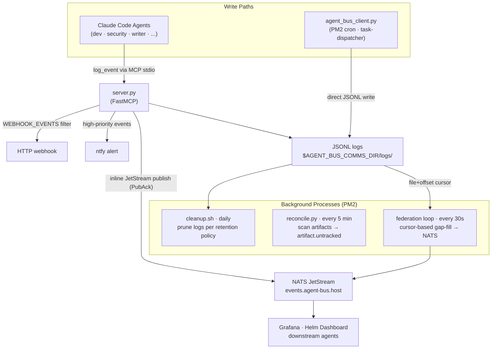

# agent-bus

[](https://claude.ai/code)
[](https://github.com/TadMSTR/agent-bus/actions/workflows/ci.yml)

A FastMCP server that provides a unified inter-agent event log for multi-agent Claude Code setups. Agents log communication events (task handoffs, audit requests, build completions) via MCP tools; events are written to local JSONL files and optionally federated to NATS JetStream for real-time observability.

## Why

When multiple Claude Code agents run concurrently — a dev agent, a security agent, a writer agent — they have no shared communication channel. Events like "the claudebox agent handed off a task to the security agent" exist only in session notes or memory files, with no queryable history.

`agent-bus` provides a lightweight event bus:
- Agents call `log_event` when they produce or consume work items
- Events are indexed in JSONL files by date and scope, chain-hashed so the log is tamper-evident
- A background federation loop replays events to NATS JetStream for downstream consumers —
  elected by an flock so exactly one process runs it, even when agent-bus is loaded as a module
  by several concurrent MCP clients
- A reconciler catches artifacts (build plans, audit requests, handoffs) that were created without a corresponding log event

## Optional Components

| Component | What it adds | Required? |
|-----------|-------------|-----------|
| NATS JetStream | Real-time event federation; stream replay for downstream consumers | No — local JSONL log works standalone |
| ntfy | Push notifications for high-priority events (task failures, audit requests) | No — events are still logged without it |
| HTTP webhook | POST event JSON to any URL on matching events — integrates with n8n, Home Assistant, Make.com, or any custom API | No |

The server operates fully without NATS, ntfy, and webhooks. Add them when you want real-time observability or push alerts.

## Architecture



## Modules

| Module | Role |
|--------|------|
| `server.py` | FastMCP server — the 5 tools above, plus the `federation_loop` background task |
| `event_log.py` | The single append path shared by every writer: `fcntl.flock` + `prev_hash` chaining + fsync |
| `event_vocab.py` | The single definition of the event vocabulary — server and client both import it, so they can't drift |
| `nats_publisher.py` | Persistent NATS connection on a background thread |
| `agent_bus_client.py` | Direct JSONL writer for non-MCP callers (see [Non-MCP Callers](#non-mcp-callers)) |
| `reconcile.py` | Scans the artifacts directory for files with no logged event |

## Installation

agent-bus is not published to PyPI, and the server is not installed as a package at all: PM2
runs `server.py` from the checkout with `venv/bin/python3`. The venv holds only the server's
dependencies, installed from the committed `uv.lock` so the set is the one CI tested and
audited. Install from a checkout of a release tag, with [uv](https://docs.astral.sh/uv/):

```bash
VERSION=0.6.0
REPO=~/repos/agent-bus
git clone https://github.com/TadMSTR/agent-bus "$REPO"
cd "$REPO"
git checkout "v$VERSION"

# 1. The checkout is clean and is exactly the release tag on the remote. A local tag
#    can be moved, and a dirty tree would run as it stands: the checkout IS the
#    deployed code.
git fetch --tags origin
test -z "$(git status --porcelain)"
# The peeled line (^{}) is listed last for an annotated tag; a lightweight tag has one line.
test "$(git rev-parse HEAD)" = \
  "$(git ls-remote origin "refs/tags/v$VERSION" "refs/tags/v$VERSION^{}" | tail -n1 | cut -f1)"

# 2. Build a fresh venv at the path the service runs from. Pin the interpreter: uv
#    otherwise prefers a Python it manages itself, which `uv python` can later remove
#    or replace under a running service. --no-install-project installs the [server]
#    dependencies and not agent-bus itself: the service runs from the source tree, and
#    an installed copy would sit unused in site-packages and misreport the version.
UV_PROJECT_ENVIRONMENT="$REPO/venv" \
  uv sync --frozen --no-install-project --extra server --python /usr/bin/python3.13

# 3. Confirm what was installed: the modules import from the checkout, and the
#    dependency versions are the locked ones.
venv/bin/python3 -c "import server, reconcile, outbox, nats_publisher"
venv/bin/python3 -c "import importlib.metadata as m; [print(p, m.version(p)) for p in ('fastmcp', 'mcp', 'cryptography', 'nats-py')]"
```

Build a fresh venv rather than installing into an existing one: an install into an existing
venv keeps whatever older dependency versions it finds there, if they still satisfy the
declared ranges. Build at the final path rather than building elsewhere and moving it: the
venv's scripts embed its path. A uv-built venv has no `pip`. Stop the service before
replacing its venv, and restart it after step 3. Every MCP client that spawns `server.py`
over stdio uses the same venv, so restart those clients too.

CI audits the locked set on every push and weekly, but nothing reads a scheduled run's
result unless you watch it. Audit the deployed venv where it runs as well (for example
`pip-audit --path venv/lib/python3.13/site-packages`).

Register with PM2:

```bash
pm2 start ecosystem.config.js
pm2 save
```

Configure as an MCP server in your Claude Desktop or Claude Code settings:

```json
{
  "mcpServers": {
    "agent-bus": {
      "command": "/path/to/agent-bus/venv/bin/python3",
      "args": ["/path/to/agent-bus/server.py"],
      "env": {
        "NATS_URL": "nats://localhost:4222",
        "NTFY_URL": "https://your-ntfy-server/your-topic"
      }
    }
  }
}
```

`NATS_URL` and `NTFY_URL` are optional — the server operates without them (local JSONL log only).

## Environment Variables

| Variable | Default | Description |
|----------|---------|-------------|
| `AGENT_BUS_COMMS_DIR` | `~/.claude/comms` | Base directory for logs, artifacts, cursors, and the key registry |
| `NATS_URL` | `nats://localhost:4222` | NATS server URL (optional) |
| `NATS_AGENT_BUS_USER` | `agent-bus` | NATS username for federation publishing |
| `NATS_AGENT_BUS_PASSWORD` | — | NATS password. Unset disables publishing entirely (no crash — the JSONL write stays authoritative) |
| `NTFY_URL` | — | ntfy topic URL for push notifications (optional) |
| `AGENT_BUS_CROSS_AGENT_RETENTION_DAYS` | `90` | Days to retain cross-agent log files |
| `AGENT_BUS_SESSION_RETENTION_DAYS` | `30` | Days to retain session log files |
| `AGENT_BUS_WEBHOOK_URL` | — | URL to POST event JSON to (optional) |
| `AGENT_BUS_WEBHOOK_EVENTS` | — | Comma-separated event types to fire on, or `*` for all (optional) |
| `AGENT_BUS_VERIFY_SIGNATURES` | `warn` | `warn` (log and accept) or `enforce` (reject unsigned events and events from unregistered sources) — see [Signing & Verification](#signing--verification) |
| `AGENT_BUS_SIG_MAX_AGE` | `300` | Freshness window, in seconds, for `sig_v: 2` signatures |
| `AGENT_BUS_STRICT_VOCAB` | `warn` | `off`, `warn` (log and accept) or `enforce` (reject) for an event type in neither vocabulary — see [Event Vocabulary](#event-vocabulary) |
| `AGENT_BUS_FEDERATION` | `1` | Set `0` to disable the federation loop entirely |
| `AGENT_BUS_FEDERATION_INTERVAL` | `30` | Seconds between federation cycles |
| `AGENT_BUS_FEDERATION_MAX_EVENTS` | `500` | Cap on events published per federation cycle |
| `AGENT_BUS_FEDERATION_MAX_SECONDS` | `10` | Wall-clock cap per federation cycle |
| `AGENT_BUS_OUTBOXES` | — | Producer outbox roots and the sources each may write as. Unset means this process drains nothing. See [Producer Outboxes](#producer-outboxes) |
| `AGENT_BUS_OUTBOX_INTERVAL` | `2` | Seconds between drain cycles, clamped to 0.2–5 |

Copy `.env.example` to `.env` and fill in the values you need. Blank values use the defaults shown above.

## MCP Tools

### `log_event`

Log an inter-agent communication event.

| Parameter | Type | Required | Description |
|-----------|------|----------|-------------|
| `event_type` | str | yes | Event vocabulary string (see below) |
| `source` | str | yes | Originating agent name |
| `summary` | str | yes | One-line human-readable description |
| `scope` | str | no | `"cross-agent"` (default) or `"session"` |
| `target` | str | no | Receiving agent name |
| `artifact_path` | str | no | Absolute path to related file |
| `metadata` | dict | no | Arbitrary key-value context |

Returns `{"id": "<uuid>", "logged": true, "scope": "<scope>"}`.

### `query_events`

Query the event log with optional filters.

| Parameter | Type | Default | Description |
|-----------|------|---------|-------------|
| `since` | str | none | ISO timestamp lower bound |
| `source` | str | none | Filter by source agent |
| `target` | str | none | Filter by target agent |
| `event_type` | str | none | Filter by event type |
| `scope` | str | `"cross-agent"` | Log file scope |
| `limit` | int | 50 | Max results (cap: 500) |

Returns events most-recent-first.

### `get_event`

Retrieve a single event by UUID.

### `get_status`

Returns the current server configuration and health: configured paths, which optional
integrations are active (NATS, ntfy, webhook), date range of available logs, and
event count for today. Use this to verify setup after installation. Integration URLs (NATS,
ntfy, webhook) have any embedded userinfo (`user:pass@`) stripped before being returned.

### `verify_chain`

Walks a JSONL log file and checks the SHA-256 hash chain for tampering or deletion. Returns
`{total_events, verified, chain_breaks, sig_failures, unsigned_events}`. Useful for
post-incident integrity checks — chain breaks indicate a line was inserted, removed, or edited
outside `log_event`/the client writers.

## Signing & Verification

Events can be signed with ed25519 and verified against a per-source key registry at
`$AGENT_BUS_COMMS_DIR/agent-keys.json`. `AGENT_BUS_VERIFY_SIGNATURES` controls what happens on a
signature problem:

- **`warn`** (default) — logs and accepts unsigned events and events from sources absent from
  the registry.
- **`enforce`** — rejects unsigned events and events claiming a source that isn't registered. A
  cryptographically invalid signature is rejected in *both* modes.

**What replay protection actually guarantees.** A captured, validly-signed event replayed
verbatim is not caught by the signature check alone — signing proves authorship, not freshness.
Signers declaring `sig_v: 2` include `sig_ts` and `sig_nonce` inside `metadata`, which is part of
the signed payload (see below), so neither can be forged or stripped without invalidating the
signature. The nonce cache that catches an exact replay is **per process**, and agent-bus
typically runs as one long-lived service plus one stdio child per MCP client — an event replayed
to a *different* process than the one that first saw it will not be caught by the nonce check.
The guarantee that holds across every process is the cryptographic freshness window: **a valid
signature, seen at most once per process, and at most ±`AGENT_BUS_SIG_MAX_AGE` seconds old** (the
window is symmetric to tolerate clock skew between agents). Size `AGENT_BUS_SIG_MAX_AGE` to the
replay exposure you're willing to accept, not to the nonce cache. Signers that predate `sig_v: 2`
are accepted but cannot be replay-checked.

Note that `ts`, `id`, `hostname`, and `prev_hash` are assigned by the server *after* the client
signs an event, so they cannot themselves be part of the signed payload — a client that wants
them covered signs `sig_ts`/`sig_nonce` in `metadata` instead, which the server does include in
what gets verified.

## Event Vocabulary

Events that automatically route to `cross-agent` scope regardless of the `scope` parameter:

| Event | When to use |
|-------|-------------|
| `task.submitted` | Task written to the queue (task-queue-mcp) |
| `task.approved` | Task approved for execution (dispatcher auto-approve, or the operator) |
| `task.pending-approval` | Dispatcher left the task for the operator to approve |
| `task.started` | Task moved to `in-progress` (task-queue-mcp) |
| `task.completed` | Task completed |
| `task.failed` | Task failed or rejected |
| `task.cancelled` / `task.parked` / `task.unparked` / `task.amended` / `task.requeued` | Operator and agent queue actions (task-queue-mcp) |
| `task.routing-failed` | No agent manifest match found |
| `task.dead-lettered` | Dispatcher gave up on a task and moved it to `dead-letters/` |
| `task.workflow-started` | Dispatcher started a Temporal workflow for the task |
| `task.dispatched` | **Deprecated, no emitter since 0.5.0.** Kept for historical records: pickup is now `task.started`, and the dispatcher's approval hand-off is `task.pending-approval` |
| `task.workflow_started` | **Deprecated spelling** of `task.workflow-started` (vikunja#553). Declared for one more release, then removed |
| `run.started` / `run.ended` | Dispatcher wrote / closed a run record (`task-launches/*.json`) |
| `hitl.requested` / `hitl.approved` / `hitl.refused` / `hitl.closed` | scoped-mcp HITL gate. Never carries a tool-argument value |
| `build.step` | Build reached a step: `pr-opened`, `merged`, `released` |
| `coderabbit.state` | `coderabbit-review-assert.py --emit-bus` recorded a PR's review state |
| `handoff.created` | Build plan or work item handed to another agent |
| `handoff.picked-up` | Agent picked up a handoff |
| `handoff.completed` | Handoff resolved |
| `audit.requested` | Security audit request written |
| `audit.completed` | Security audit report written |
| `build-plan.created` | New build plan added to queue |
| `diagnose.started` | Diagnostic session begun |
| `diagnose.completed` | Diagnostic session concluded |
| `artifact.untracked` | File in artifacts dir with no log entry (reconciler) |
| `preflight.started` | Build preflight check begun |
| `preflight.completed` | Build preflight check finished |
| `build.started` | Build phase execution begun |
| `build.completed` | Build phase execution finished |
| `deploy.started` | Deployment begun |
| `deploy.completed` | Deployment finished |
| `security.finding` | Security agent logged a finding |
| `tracker.ticket.created` | Vikunja ticket filed by an agent |
| `config.proposal.countersign_requested` | steward asked security to countersign a config change |
| `config.proposal.countersigned` | security recorded a countersign verdict |
| `agent-workflow.changed` | An agent's manifest or workflow was changed |
| `update.cycle.completed` | Scheduled update cycle finished |
| `compact_qc.complete` | Memory-compaction QC run finished |
| `rollover_qc.complete` | Memory-rollover QC run finished |

High-priority events that also trigger a push notification: `audit.requested`, `task.failed`, `task.routing-failed`, `task.dead-lettered`, `handoff.created`.

**The lifecycle events are emitted by the component that changes the state**, after the
write succeeds: task-queue-mcp for task transitions, task-dispatcher for approvals, dead
letters, workflows and runs, scoped-mcp for HITL. Agents do not log them by hand.

### Session-scoped events

| Event | Emitter |
|-------|---------|
| `tool.called` | scoped-mcp's audit trail (writes the session JSONL directly) |
| `workspace.drift` | `agent-workspace-scan.py` |
| `workspace.healed` | `agent-workspace-scan.py` |

These go to a separate daily log file and are not federated to NATS. Pass `scope="session"`.

### An undeclared event type routes cross-agent, and is reported

An event type in neither table is **not** filed wherever the caller asked. It goes to the
**cross-agent** log regardless, because "nobody has decided where this belongs" is not a reason
to put it in the quiet file.

This is the vikunja#560 fix. `log_event` never validated `event_type`, so an unknown type kept
the caller's `scope`. `task.workflow_started` reached the cross-agent log for months purely
because every caller happened to leave `scope` at its default — one caller passing
`scope="session"` would have diverted it somewhere no `query_events(scope="cross-agent")` and no
federation would ever look again.

`AGENT_BUS_STRICT_VOCAB` controls what is *reported* on top of that routing:

| Mode | Behaviour |
|------|-----------|
| `off` | No report. The routing fix still applies — the divert was the bug, not the silence. |
| `warn` (default) | Logs `vocabulary_policy …` and accepts the event. |
| `enforce` | Rejects it: the MCP tool returns `{"logged": false, "error": …}`; the Python client raises `VocabularyError`. |

An unrecognised value is treated as `warn`, not as `off` — a typo in a policy variable must not
silently disable the policy.

**`enforce` is not yet reachable on forge.** A reconciliation of the live corpus on 2026-08-29
found roughly forty types still in active use that are not declared above, so `enforce` today
would drop real events from real agents. Only types with a *sanctioned emitter* were added;
apparent drift (`build.complete` beside `build.completed`, `plane.ticket.*` from a tracker
retired in July) was deliberately left undeclared, because declaring a typo turns this gate into
a rubber stamp. Watch what `warn` logs, fix the emitters, then flip.

**Both writers are gated.** The check lives in `event_vocab.py` and runs in `server.py` *and*
`agent_bus_client.py`. task-dispatcher — the emitter whose undeclared `task.workflow_started` is
the worked example above — writes through the client, so a gate only in the MCP server would
have left exactly the caller it was designed for ungated.

## Storage Layout

```
$AGENT_BUS_COMMS_DIR/          (default: ~/.claude/comms)
├── logs/
│   ├── 2026-03-29-cross-agent.jsonl   # inter-agent events
│   └── 2026-03-29-session.jsonl       # session-scoped events
├── artifacts/
│   ├── build-plans/
│   ├── audit-requests/
│   ├── audit-reports/
│   ├── diagnose-sessions/
│   └── handoffs/
├── outbox/<producer>/                  # producer outboxes (see Producer Outboxes)
├── outbox-status.json                 # the drainer's heartbeat, read by get_status
├── federation-cursor.json             # NATS federation offset tracker
└── .reconcile-cursor                  # reconciler mtime watermark
```

Each JSONL line is a complete event object:

```json
{
  "id": "a1b2c3d4-...",
  "ts": "2026-03-29T14:30:00+00:00",
  "event": "handoff.created",
  "scope": "cross-agent",
  "source": "claudebox",
  "target": "security",
  "artifact_path": "/home/user/.claude/comms/artifacts/audit-requests/my-build/request.md",
  "summary": "Security audit request: my-build",
  "hostname": "myhost",
  "metadata": {}
}
```

## NATS Federation

Events are published to **`events.agent-bus.{hostname}`** on the local NATS server, and the
`AGENT_BUS` JetStream stream captures `events.agent-bus.>` with:
- 30-day retention (`max_age`)
- 2-minute dedup window (covers inline + federation-loop double-publish)
- Storage: file

> **This section used to name the wrong subject, and that mistake had consequences.** It said
> events went to `agent-bus.{hostname}.events` and that the stream should capture `agent-bus.>`.
> The code has always published to `events.agent-bus.{hostname}` (`server.py`), so a stream
> built from the old text would have matched **nothing** — and, because `nats.conf` grants the
> `agent-bus` user `publish: ["events.>"]`, the subject this file named was not merely unmatched
> but unauthorised. A stream created from these instructions would have existed, reported a
> healthy `jsz` count, and retained none of this server's events. Corrected 2026-08-29;
> tracked as vikunja#562. **The code is authoritative, not this file.**

Publishing itself is handled by a single persistent NATS connection held on a background thread
(`nats_publisher.py`) — `log_event` enqueues onto a bounded queue and returns immediately; it
never blocks and never raises, so a NATS outage cannot affect the JSONL write, which stays
authoritative.

### Publishing is via JetStream, so "no stream" is an error

`nats_publisher.py` publishes with `js.publish()` and waits for a **PubAck**. This is not a
detail: the previous core `nc.publish()` succeeded and discarded the message whenever no stream
matched the subject, then incremented the success counter on the next line. On 2026-08-28 the
server was measured with **zero streams** while every counter reported months of clean
publishes — agent-bus had been federating into a void and no health surface could say so
(vikunja#561).

Consequences worth knowing:

- `published` in `get_status` counts PubAcks, i.e. events **accepted by a stream**.
- `stream` reports which stream is capturing the configured subject, resolved from the server
  **by subject** — not by name, because a name lookup would have reported healthy against a
  stream matching nothing this server sends. `null` means nothing is retaining these events.
- The federation loop gates on `deliverable` (connected **and** a stream matches), not on
  `connected`. Connected-with-no-stream is exactly the state that persisted for three months;
  advancing the cursor through it would mark discarded events as delivered.
- There is deliberately **no fallback to core publish**. A fallback would restore the silent
  discard along with the false success.

The federation loop re-publishes from a per-file offset cursor (`federation-cursor.json`, format
version 2) every `AGENT_BUS_FEDERATION_INTERVAL` seconds (default 30) to fill gaps from NATS
downtime, skipping any file whose recorded offset already equals its size. It runs in exactly one
process at a time — every process that loads agent-bus takes a non-blocking exclusive lock on a
`.federation.lock` file; the lock holder federates and the rest retry, so it fails over without
configuration. Each cycle is bounded by `AGENT_BUS_FEDERATION_MAX_EVENTS` and
`AGENT_BUS_FEDERATION_MAX_SECONDS` so a cursor reset degrades to slower catch-up rather than one
long blocking cycle. Set `AGENT_BUS_FEDERATION=0` to disable the loop entirely. Consumers should
treat the stream as **at-least-once**.

## Non-MCP Callers

For Python scripts that can't call MCP directly (e.g., PM2 cron jobs), use `agent_bus_client.py`:

```python
from agent_bus_client import log_event

log_event(
    event_type="task.dispatched",
    source="task-dispatcher",
    target="claudebox",
    summary="Build phase 1 dispatched to claudebox agent",
)
```

The client writes directly to the JSONL files using the same schema as the server — no MCP round-trip, no external dependency.

## Producer Outboxes

Some producers cannot reach the chained log. task-queue-mcp runs in a read-only container
whose only mount is the queue directory; scoped-mcp is a public package that should not
depend on agent-bus; `coderabbit-review-assert.py` is a stdlib script. Each writes **one JSON
file per event** into an outbox directory it can already write, and agent-bus drains those
files into the cross-agent log through the same flocked, chained append as everything else.

### The file contract

| | |
|---|---|
| Name | `<YYYYmmddTHHMMSS.ffffff>-<uuid4>.json`, UTC. Write `.tmp-<anything>` in the same directory, then `rename` it into place. Dot-files are never read |
| Body | A JSON object with **exactly** `id`, `ts`, `event`, `source`, `target`, `summary`, `metadata` |
| `id` | The uuid in the file name. It becomes the bus event id, and it is the dedupe key |
| `ts` | ISO 8601 with a UTC offset: when the state change happened |
| `event` | A type in `CROSS_AGENT_EVENTS` |
| `source` | Must be on that root's allowlist |
| `target` | String or `null` |
| `summary` | At most 300 characters |
| `metadata` | An object, at most 4 KiB encoded |
| File | At most 8 KiB |
| Not allowed | `scope`, `prev_hash`, `hostname`, `sig`. agent-bus assigns the first three; outbox events are not signed |

`outbox.validate_event(obj, name, allowed_sources)` is the gate. It is stdlib-only, so a
producer's test suite can import it to prove its own writer's output passes, without
installing the server.

### Configuration

```
AGENT_BUS_OUTBOXES=/srv/agents/task-queue/.outbox=task-queue-mcp;/srv/agents/comms/outbox/scoped-mcp=scoped-mcp;/srv/agents/comms/outbox/coderabbit-review-assert=coderabbit-review-assert
```

Entries are separated by `;`, each `<absolute path>=<source>[,<source>…]`. A malformed value
does not stop the server, because `log_event` must keep working, but it turns draining off and
`get_status().outboxes.config_error` says why.

Only a process with `AGENT_BUS_OUTBOXES` set drains, and only the one holding
`$AGENT_BUS_COMMS_DIR/.outbox-drain.lock`. On forge that is the PM2 app. The stdio children
spawned per broker do not carry the variable. The federation lock is not reused: it goes to
whichever process starts first, usually a stdio child with no outboxes configured.

### What the drainer does

Every `AGENT_BUS_OUTBOX_INTERVAL` seconds, up to 500 files per cycle, in name order:

1. Refuse anything that is not a regular file owned by the drainer's uid (symlinks are
   moved, never followed), then validate the body. **An unknown event type is refused
   whatever `AGENT_BUS_STRICT_VOCAB` says**: this path is new, and nothing written through
   it predates the vocabulary.
2. A refused file is moved to `<root>/.rejected/` beside a `<name>.reason` file holding one
   fixed reason string, and logged. It is never dropped silently.
3. A valid file is appended (with `"ingest": "outbox"` and `ingested_at`), fanned out to
   NATS, ntfy and the webhook exactly as `log_event` would, and then deleted.
4. Append first, delete second. After a crash between the two, the restarted drainer finds
   the id in the last two days' log and deletes the file without appending it again.

### The drainer is not steerable by its producer

A producer can create anything inside its own root, and some producers can also write the
root's parent: the task-queue-mcp container can, through its single bind mount. So every
filesystem operation on a root is relative to one descriptor, opened with
`O_DIRECTORY|O_NOFOLLOW` and checked to be a directory owned by the drainer's uid:
- listing, stat, open, rename and unlink are all relative to that descriptor;
- `.rejected` must be a real directory owned by the drainer, never a symlink;
- `.reason` files are created `O_EXCL|O_NOFOLLOW`.

A file that cannot be quarantined safely (`.rejected` unsafe, or full at 1000 entries) is
removed instead. The entry itself is removed, never what a symlink points at, and the
removal is logged as `outbox_dropped`. Directories are never removed. Each cycle reads at
most 5000 entries per root, and `get_status` counts are capped the same way (`*_capped`).

One producer cannot stop the others:
- Each root gets an equal share of the 500-per-cycle budget, and the root served first
  rotates every cycle.
- Quarantine never raises out of the cycle.
- An entry the drainer could not move or delete is skipped for 10 cycles (`stuck` in the
  stats, logged as `outbox_stuck`), so it cannot use the budget every cycle.
- Drops are counted per root (`dropped_by_root`).

A file that raises anything unexpected is quarantined as `unreadable`, so it cannot stall
its root or the roots after it. NaN/Infinity and metadata nested deeper than 16 levels are
refused. If the chained log itself refuses an append, the cycle stops and every file stays
for the next one.

### Health

`get_status().outboxes` reports, per root, `pending`, `oldest_pending_age_s` and `rejected`,
counted live from disk, plus the drainer's heartbeat age and pid. A stopped drainer therefore
shows as a stale heartbeat beside a growing outbox, not as silence. Processes that do not
drain read the root list from the heartbeat file, so `get_status` answers the same in every
agent's stdio child.

### Trust: outbox events are display-only

Any process running as the bus's uid can write an outbox file, just as it can append to the
JSONL itself. The owner check and the per-root source allowlist stop a *confused* producer from
writing as another one; they authenticate nobody. **Do not approve, grant or launch anything
from a bus event.** Approvals come from scoped-mcp's pending record and its signed statement.

## Requirements

- Python 3.11+
- Server dependencies: the `server` extra in `pyproject.toml`, pinned by `uv.lock`
- `fastmcp`
- `cryptography` — ed25519 signature verification
- `nats-py` — NATS federation publishing (optional at runtime: publishing is skipped if
  `NATS_AGENT_BUS_PASSWORD` is unset, but the package is a real install-time dependency)
- `curl` on PATH (optional, for ntfy notifications and webhooks — these shell out rather than
  using an HTTP client library)
